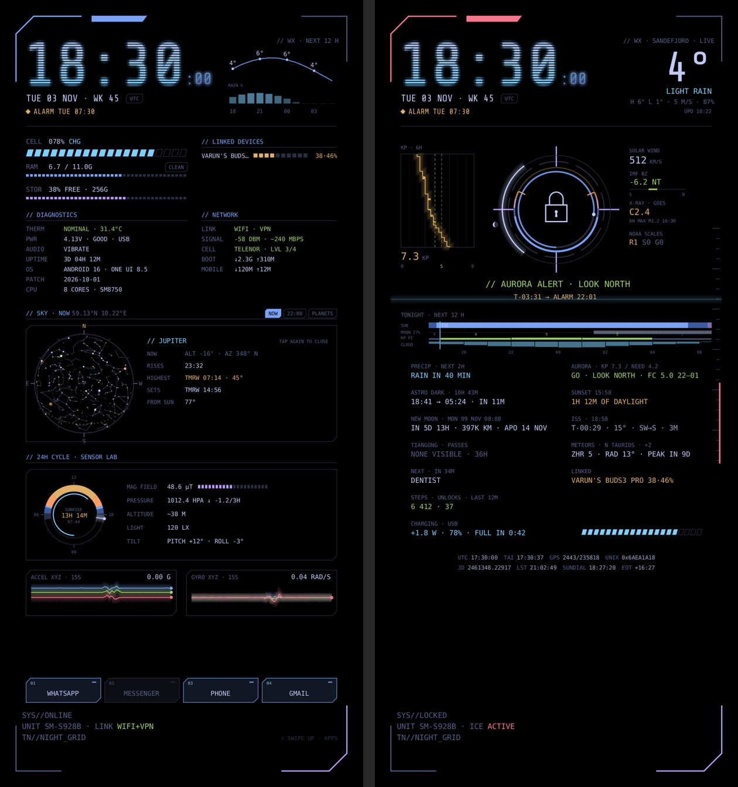

# TN-HUD for Android

A Tokyo Night, Cyberpunk-2077-style HUD for Samsung (One UI) phones: an AMOLED-black **live wallpaper** that turns the home screen into a dashboard, the lock screen into a space-weather and sky console, and a **charging screen saver** into a GNSS / deep-space monitor. Plus a matching **icon pack** that frames your original app icons.

<p align="center">
  
</p>

Built for a Galaxy S24 Ultra (1440×3120) but resolution independent. Android 8.0+ (API 26), tested design target One UI 8.

## What's in it

**Home screen** (virtual tabs, since One UI doesn't report home-screen pages to wallpapers)
- Clock (Share Tech Mono "scanline hologram"), weather with a tap-to-show 12 h strip
- Device: battery, RAM (with Device care shortcut), storage, diagnostics, network, linked Bluetooth devices with battery levels
- Sky: live star map with constellations, Moon and planets; tap a body for rise / highest / set
- Sensors: 24 h sun dial and a sensor lab (magnetometer, barometer and trend, light, tilt, accelerometer / gyro traces)
- Calendar (day / week / month), Google search bar, media controls, Notes / Keep shortcuts
- Shortcut row: up to 4 text blocks for your apps
- Per-view module selection and drag-to-reorder, automatic tab switching (headphones, charging, night, morning)

**Lock screen**
- Breach-style unlock animation, header clock and weather
- Aurora verdict (Kp, Bz, darkness, clouds) with NOAA 3-day Kp forecast, 6 h Kp trace, solar wind, GOES X-ray class, NOAA R/S/G scales, storm and flare alerts
- Visible ISS / Tiangong passes and Starlink trains (on-device SGP4), live pass plot inside the ring
- "Tonight" timeline: twilight depth, Moon, Kp forecast, cloud, passes
- Darkness window, meteor showers, moon phase / perigee, time scales (UTC, TAI, GPS, Unix, JD, LST, sundial / EoT)
- Every tile reorderable and switchable

**Launcher** (optional home app, Settings › Apps › Choose default apps › Home app → *TN-HUD Launcher*)
- The HUD becomes the home screen and owns the touches: no icons over it, no misfires from the app drawer
- Swipe left / right changes tabs, long-press for the menu
- Remappable gestures: swipe up, swipe down (left / right side), two-finger swipe down, double tap, home button while home → app drawer, notifications, quick settings, torch, camera, next tab, HUD settings or any app
- Swipe up: app drawer as a text list, icon + text list, or icon grid with or without labels (4–6 columns, original / mono / neon icons), search field focused and the keyboard up; Enter opens the top match (or searches the web), A–Z rail, frequent apps (launches decayed over ~2 weeks), rename / hide / app info / uninstall, hidden apps behind a "show hidden" row, work-profile apps tagged
- Command line in the drawer search: start with `>` for T-UI style commands (`> torch`, `> wifi`, `> timer 5`, `> alarm 7:30`, `> call <name|number>`, `> wa <name>`, `> tg <name>`, `> web <query>`, `> maps <place>`, `> hide <app>`, `> info <app>`, `> help` for the full list); names match by prefix, Enter runs the top match
- App shortcuts (new chat, compose, …) at the top of an app's long-press menu
- Its own *Launcher* tab in the settings app: home app, drawer style, gestures and glyphs
- Glyphs: draw a letter on the home screen (W, M, V, N, Z, L, C, O, S, G, P, ✓, Λ, >) to open an app or run any gesture action; built-in shapes plus your own taught samples, neon trail with the recognised glyph
- Rofi-style pop-up: `>` glyph opens a frosted-glass prompt with live results (most-used apps, apps by name, `>` commands); the C glyph opens it as `> call` with contact suggestions. `> wa`, `> wav` and `> tg` start WhatsApp voice / video and Telegram calls through the call entries those apps add to the system contacts (needs their contact sync; unofficial, may change)
- Pop-up extras: `= 2*pi*4` (or any arithmetic) calculates and copies the result; `$ command` runs in Termux and shows the output (Termux needs `allow-external-apps = true`); plain text also finds app shortcuts and Android settings pages; search tolerates initials ("gm") and one typo
- HUD panel: grouped notifications (tap a group to expand), swipe sideways to dismiss, inline reply for messaging apps (TN-HUD Link v2), media card with transport controls, quick toggles that really switch (auto-rotate, adaptive brightness and a brightness slider with "Modify system settings"; battery saver and location after a one-time `adb shell pm grant com.tokyonight.hud.live android.permission.WRITE_SECURE_SETTINGS`)
- Panel everywhere: optional accessibility service ("TN-HUD pull-down") puts an invisible strip on part of the top edge of any app; dragging down from it opens the HUD panel over the app. Reads no screen content
- Quick settings tiles: "HUD panel" and "HUD launcher"
- Icon packs (ADW / Nova format, TN-HUD-Icons included) with frame and colour on top, per-app "keep the original icon", rendered icons cached on disk
- Widget slot: a HUD module that hosts one real app widget (e.g. Samsung Music for track info); choose it with a long-press on home

**Notification link** (optional companion, `TN-HUD-Link.apk`)
- Holds notification access so the main app never has to (Play Protect blocks that permission for sideloaded apps)
- Unread badges in the drawer and on the shortcut row, track info and transport controls from any player (Samsung Music included)
- HUD notification panel in the launcher (map it to a gesture): open / dismiss / clear all, torch, Do Not Disturb, Wi-Fi, internet, Bluetooth and volume panels
- Talks only to TN-HUD Live, through a signature permission (both APKs must share the signing key); no internet permission
- Install with `adb install TN-HUD-Link.apk` or Shizuku. Installed from a browser / file manager, Android greys out notification access until you use *App info › ⋮ › Allow restricted settings*

**Screen saver** (Settings › Display › Screen saver → "TN-HUD · GNSS", charging only)
- Sky plot of every GNSS satellite in view by constellation, C/N0 bars, dual-band flags, fix and TTFF
- Voyager 1 / 2 distance and light-time
- Burn-in protection (dim palette, offset jumps every minute)

**Everything else**
- Notifications for aurora GO, G2+ storms, visible passes and Starlink trains (quiet hours)
- Red night mode, night dimming (30–70 %), separate text sizes for home / lock / screen saver
- Taps: off / tap / double tap for system shortcuts, ignored while the app drawer is open
- Settings backup / restore / share, diagnostics page, Material 3 settings app with in-app permission management

More screenshots in [`docs/screenshots`](docs/screenshots).

## Install

1. Download `TN-HUD-Live.apk` (and optionally `TN-HUD-Icons.apk`) from the releases, or build it (below).
2. Open it on the phone and allow installs from that app.
3. **Long-press the home screen › Wallpaper and style › Change wallpapers › Live wallpapers** (or open *TN-HUD Live* and tap *Set wallpaper*). Apply to home **and** lock screen.
4. Open *TN-HUD Live* for settings. Everything that needs a permission is optional; the **Permissions** tab explains and manages each one.

Tips
- Hide Samsung's own lock-screen clock with Good Lock › ClockFace (an empty custom clock), so the HUD header shows instead.
- Removed the favourites dock? Turn on *Home › Display › No dock*.
- Icon pack: apply it with a launcher that supports ADW/Nova-format icon packs.

### Play Protect

Sideloaded apps that ask for notification access, accessibility, SMS or "display over other apps" are blocked by Play Protect's enhanced fraud protection. TN-HUD deliberately uses none of these. If you ever add such a permission, install with `adb install` instead.

## Build

No Gradle. You need a JDK (8+, tested with 17/21) and the Android SDK command-line pieces:

```sh
sdkmanager "platforms;android-23" "build-tools;34.0.0"
export ANDROID_HOME=~/Library/Android/sdk     # macOS default; ~/Android/Sdk on Linux
./build.sh          # -> dist/TN-HUD-Live.apk
./build.sh icons    # -> dist/TN-HUD-Icons.apk
./build.sh link     # -> dist/TN-HUD-Link.apk (notification companion)
./build.sh all
```

The pipeline is `javac → d8 (or dx) → aapt → zipalign → apksigner`. The code compiles against the API 23 jar on purpose; newer APIs are called by reflection or via the compile-only stubs in `app/stubs` (never packaged).

### GitHub Actions

`.github/workflows/build.yml` runs `test.sh` and builds both APKs on every push and pull request (download them from the run's *Artifacts*). Pushing a tag such as `v32` also publishes a release with the APKs attached, which Obtainium can follow.

To sign CI builds with your key, add three repository secrets (*Settings › Secrets and variables › Actions*):

```sh
base64 -i keystore/tn-hud.jks | pbcopy     # paste as KEYSTORE_BASE64
# KS_PASS   = keystore password
# KEY_ALIAS = tnhud
```

Without the secrets the workflow signs with a throwaway key (artifact name ends in `-throwaway`): fine for testing, but it won't install over your own build, and no release is published.

### Signing

`build.sh` signs with `keystore/tn-hud.jks` (alias `tnhud`) unless you set `KEYSTORE`, `KEY_ALIAS` and `KS_PASS`. The `keystore/` folder is git-ignored: **never commit a keystore**. Android only installs an update over an existing install if it's signed with the same key, so keep a backup of yours. To make a new one:

```sh
mkdir -p keystore
keytool -genkeypair -keystore keystore/tn-hud.jks -alias tnhud -keyalg RSA -keysize 4096 -validity 36500
```

### Preview and tests (desktop only)

```sh
./preview.sh                  # renders home / lock / unlock / pass / storm stills to build/preview
./preview.sh AodPreview       # the screen saver
./test.sh                     # SGP4 + pass prediction, astronomy, NOAA feed parsing
```

The renderer (`HudRenderer`) only uses `android.graphics`, so `app/shim` provides a small AWT implementation of those classes and the HUD can be drawn on any JDK. SGP4 output matches python-sgp4 to the metre; look angles match skyfield to 1e-4°; moon phases and twilight were checked against PyEphem.

## Project layout

```
app/
  AndroidManifest.xml
  src/com/tokyonight/hud/live/
    HudWallpaper.java    wallpaper engine: lock/unlock/home state machine, sensors, data jobs, taps
    HudRenderer.java     everything drawn (pure android.graphics)
    HudDream.java        charging screen saver (GNSS + Voyager)
    HudLauncher.java     optional home app: gesture shell over the wallpaper + text-only app drawer
    Commands.java        drawer command line table (">" prefix)
    Rofi.java            rofi-style launcher pop-up (glyphs > and C)
    Shade.java           HUD notification / toggle panel, shared by the launcher and ShadeService
    ShadeService.java    accessibility overlay: pull-down strip, panel over any app
    Toggles.java         toggles reachable with WRITE_SETTINGS / WRITE_SECURE_SETTINGS, torch
    Tiles.java           quick settings tiles
    Calc.java            pop-up calculator
    Termux.java          "$ command" through Termux RUN_COMMAND (TermuxRx gets the result)
    IconPacks.java       ADW / Nova icon pack loader
    Glass.java           frosted-glass Tokyo Night dialogs
    SetWallpaper.java    Material 3 settings app
    Astro.java           Sun / Moon / planets, twilight, lunar events, meteors, Voyager model
    Sgp4.java, Sat.java  SGP4 propagator, look angles, visible-pass and Starlink-train detection
    SpaceWx.java         NOAA SWPC feeds, aurora verdict
    Alerts*.java         notifications, periodic job, pass alarms
    Link*.java           receives the companion's state, sends it commands
    HudBus.java          in-process hand-off between the wallpaper and the launcher (widget slot)
    Glyph.java, Gestures.java  glyph recogniser, gesture / action mapping
    Backup.java, Shortcuts.java
  res/, assets/          resources, font, packed star catalogue
  stubs/                 compile-only API stubs (not packaged)
  shim/                  AWT shim + preview mains
  test/                  pure-Java checks
link/                    TN-HUD Link: notification-listener companion (badges, media, notification panel)
icons/                   icon pack (code-free APK: frame back / mask / upon at scale 0.92)
docs/screenshots/
third_party/             licenses of bundled third-party material
```

## Privacy

No accounts, no analytics. Network use: Open-Meteo (weather; rounded coordinates or your city), NOAA SWPC (space weather, every 15–30 min while the HUD is visible), CelesTrak (orbital elements, once a day). Those services see only your IP address; aurora, passes, twilight and everything else are computed on the phone. Calendar, steps, sensors, GNSS and Bluetooth data never leave the device.

## License

MIT, see [`LICENSE`](LICENSE). Bundled font and star data keep their own licenses, see [`THIRD_PARTY_NOTICES.md`](THIRD_PARTY_NOTICES.md).
